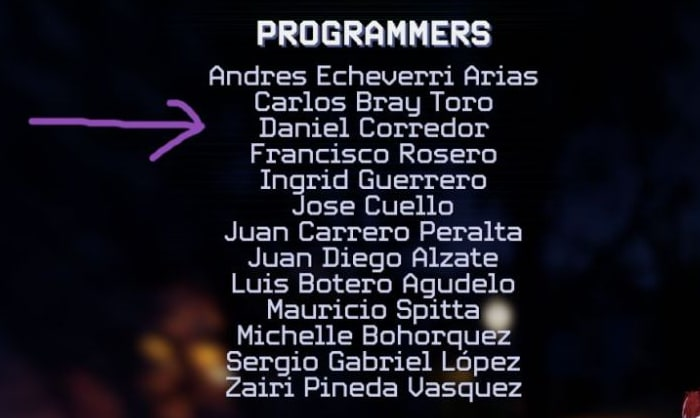
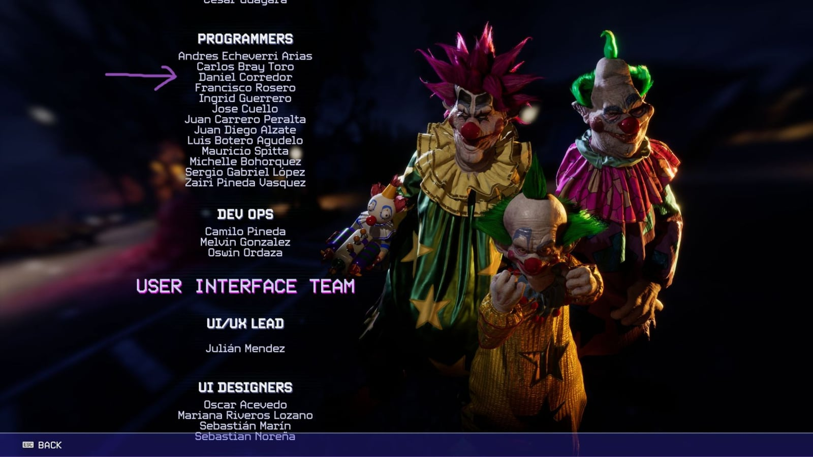

*Video: the official launch trailer. It shows the game, not only my part of it.*

## What I built

My work on the team was broad: I worked across many character abilities and shared gameplay systems.

- Co-developed replicated multiplayer gameplay systems and core mechanics in C++ and Blueprints, using the Gameplay Ability System (GAS) for character abilities.
- Prototyped and built gameplay tools, with maintainable and optimized code, so the design and art teams could iterate fast.
- Profiled game performance and fixed complex multiplayer replication bugs, keeping network synchronization and frame rates stable across target platforms.
- Worked with Art, Audio and QA to deliver complete features, and documented every technical implementation in Confluence.

### An ability I built: Shorty's Pizza Box

Shorty, one of the Klowns, turns into a pizza box with legs, walks around the map blending into the scenery, and ambushes a human player with an uppercut that kills instantly.

- I built the ability and made it fully functional on my own, with the Gameplay Ability System (GAS) and a mix of C++ and Blueprints.
- The hard part was multiplayer: keeping the sounds and animations in sync for every player.

## Multiplayer bugs I fixed

Most of the bugs I fixed were replication bugs:

- **RPCs:** fixed gameplay that broke between server and clients by correcting how RPCs were used.
- **Net dormancy:** fixed bugs in actors whose network dormancy was not handled correctly.
- **UI for a subset of players:** fixed UI that had to be visible only to a specific group of players.

## Credits

I am credited under **Programmers** in the game's credits.

The full credits screen:

