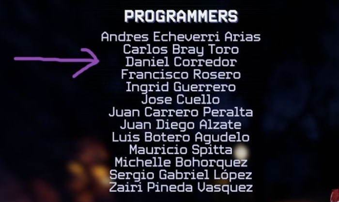
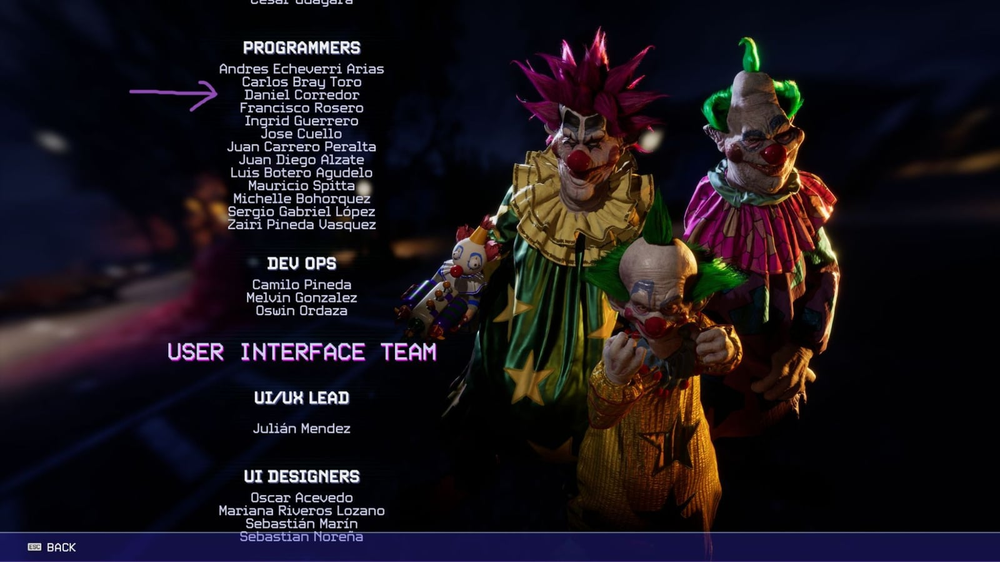

## What I built

My work on the team was broad: I worked across many character abilities and shared gameplay systems. I was on the project during development, from June 2021 to April 2023; the game was released in June 2024.

### An ability I built: Shorty's Pizza Box

Shorty, one of the Klowns, turns into a pizza box with legs, walks around the map blending into the scenery, and ambushes a human player with an uppercut that kills instantly.

- I built the first version of the ability on my own, with the Gameplay Ability System (GAS) and a mix of C++ and Blueprints: the transformation, the movement and the ambush.
- The hard part was multiplayer: keeping the sounds and animations in sync for every player.
- The team kept polishing it after I left the project, so the final game looks better than my version did.

## Multiplayer bugs I fixed

Most of the bugs I fixed were replication bugs:

- **RPCs:** fixed gameplay that broke between server and clients by correcting how RPCs were used.
- **Net dormancy:** fixed bugs in actors whose network dormancy was not handled correctly.
- **UI for a subset of players:** fixed UI that had to be visible only to a specific group of players.

## Also on the project

- Co-developed replicated multiplayer gameplay systems and core mechanics in C++ and Blueprints, using the Gameplay Ability System (GAS) for character abilities.
- Prototyped and built gameplay tools, with maintainable and optimized code, so the design and art teams could iterate fast.
- Worked with Art, Audio and QA to deliver complete features, and documented every technical implementation in Confluence.

## Credits

I am credited under **Programmers** in the game's credits. Below, a close-up of that section and the full credits screen.

